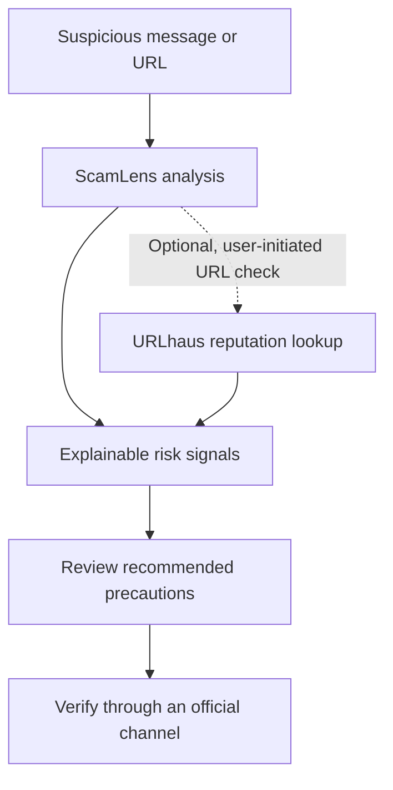

<!--
  ScamLens — pause the panic, see the signal.
  Keep this README accurate as the product evolves.
-->

<div align="center">

# 🛡️ ScamLens

### Pause the panic. See the signal.

**An everyday scam-safety companion that helps you inspect suspicious messages and links, understand the warning signs, and make a more informed decision before you click, reply, or share.**

<p>
  <a href="https://github.com/veds-2246/ScamLens"></a>
  
  
  
</p>

<p>
  <a href="#-why-scamlens">Why ScamLens</a> ·
  <a href="#-features">Features</a> ·
  <a href="#-get-started">Get started</a> ·
  <a href="#-privacy--safety">Privacy & safety</a>
</p>

</div>

---

## 🔎 Why ScamLens?

Scams are designed to make people react quickly. They use urgency, fear, impersonation, suspicious links, and requests that feel just believable enough.

ScamLens gives people a calmer way to pause and investigate. It surfaces understandable risk signals instead of asking users to blindly trust a label or score.

> **The goal isn't to replace your judgment. It's to help you make it stronger.**

## ✨ Features

| Capability | What it does |
| --- | --- |
| 💬 **Suspicious-message analysis** | Highlights patterns such as urgency, pressure, impersonation, and suspicious requests. |
| 🔗 **URL inspection** | Examines URL structure and risk indicators without opening the submitted website. |
| 🧭 **Explainable signals** | Helps users understand *why* something deserves a closer look and what to do next. |
| 🦠 **Optional URLhaus lookup** | Lets a user explicitly check a URL against URLhaus's known malware-distribution dataset. |
| 🗂️ **Analysis history** | Keeps reports available locally, with optional account-based cloud history when Supabase is configured. |
| 🔐 **Optional authentication** | Supports Supabase email sign-up/sign-in and account-scoped history. |
| 📚 **Security awareness** | Encourages repeatable habits: pause, check, verify, then decide. |
| 📱 **Responsive interface** | Includes a product landing page and an analysis workspace designed for different screen sizes. |

### 🧠 Designed to explain, not overpromise

ScamLens uses heuristic signals. A score is **not a calibrated probability**, a verdict from a human analyst, or proof that a message or URL is safe or malicious. Treat the result as a starting point for further verification.

## 🔄 How it works



1. **Bring the message or link.** Enter the content you want to examine. Avoid private links, passwords, one-time codes, and other sensitive information.
2. **Review the signals.** Read the indicators and explanations rather than relying on a score alone.
3. **Verify independently.** Contact the organization through its official app, website, or a known phone number before taking action.
4. **Learn for next time.** Use the report to recognize common social-engineering patterns.

## 🧰 Tech stack

- **Framework:** Next.js App Router
- **Language:** TypeScript
- **UI:** React, custom CSS, Lucide icons
- **Package manager:** pnpm
- **Authentication and optional cloud history:** Supabase SSR and Supabase JS
- **Optional URL reputation:** URLhaus Community API via a server-side route
- **Quality checks:** ESLint, TypeScript, and Node.js test runner

## 🚀 Get started

### Prerequisites

Install a compatible Node.js version for your Next.js installation and **pnpm**.

### 1. Clone the repository

```bash
git clone https://github.com/veds-2246/ScamLens.git
cd ScamLens
```

### 2. Install dependencies

```bash
pnpm install
```

### 3. Configure environment variables (optional)

Copy the example file:

```bash
cp .env.example .env.local
```

Add only the configuration for features you intend to use:

```dotenv
# Optional: server-side URLhaus reputation checks
URLHAUS_AUTH_KEY=your_urlhaus_auth_key

# Optional: Supabase authentication and cloud history
NEXT_PUBLIC_SUPABASE_URL=https://your-project-ref.supabase.co
NEXT_PUBLIC_SUPABASE_PUBLISHABLE_KEY=sb_publishable_your_key
```

- **Local analysis:** the app's local analysis features can be used without configuring Supabase or URLhaus.
- **Supabase:** create a Supabase project, configure its URL and publishable key, apply the reviewed SQL migration in `supabase/migrations/`, and configure the appropriate authentication redirect URLs. Keep database access policies enabled.
- **URLhaus:** obtain an API key through the official [abuse.ch authentication portal](https://auth.abuse.ch/). Keep `URLHAUS_AUTH_KEY` server-side. Never prefix it with `NEXT_PUBLIC_` or commit it to Git.
- **Never use a Supabase service-role key in browser-exposed variables.** The publishable key is intended for client configuration; database permissions must still be enforced by policies.

### 4. Start the development server

```bash
pnpm dev
```

Open [http://localhost:3000](http://localhost:3000).

### 5. Run quality checks

```bash
pnpm test
pnpm lint
pnpm exec tsc --noEmit
pnpm build
```

## ⚙️ Environment configuration

| Variable | Required? | Purpose |
| --- | --- | --- |
| `URLHAUS_AUTH_KEY` | No | Enables the optional server-side URLhaus reputation check. |
| `NEXT_PUBLIC_SUPABASE_URL` | No | Supabase project URL for authentication and cloud history. |
| `NEXT_PUBLIC_SUPABASE_PUBLISHABLE_KEY` | No | Supabase publishable key for client/SSR setup. |

See [`.env.example`](.env.example) for placeholders and [the URLhaus setup guide](docs/urlhaus-threat-intelligence.md) for details. Do not commit `.env.local` or real credentials.

## 🗺️ Project structure

```text
ScamLens/
├── src/
│   ├── app/
│   │   ├── api/threat-intel/    # Optional server-side URLhaus lookup
│   │   ├── app/                 # Analysis workspace
│   │   ├── auth/                # Sign-in, sign-up, callback routes
│   │   ├── page.tsx             # Landing page
│   │   ├── global.css           # Workspace styles
│   │   └── landing.css          # Landing page styles
│   ├── components/              # Shared UI components
│   ├── lib/                     # Analysis, history, and Supabase helpers
│   └── types/                   # Shared TypeScript types
├── supabase/migrations/         # Database schema and row-level policies
├── tests/                       # Automated tests
├── docs/                        # Integration and setup documentation
├── proxy.ts                     # Auth session refresh / request handling
├── .env.example                 # Safe environment variable placeholders
└── package.json
```

## 🔐 Privacy & safety

ScamLens is built to encourage careful decisions and limit unnecessary exposure of submitted content.

- **Local-first checks:** local analysis is performed by the app without needing an external reputation lookup.
- **External lookup is opt-in:** URLhaus is contacted only when a user explicitly requests a reputation check. The submitted URL may include its path and query string, so never submit private, password-reset, or one-time links.
- **No website visit:** the URLhaus route sends the URL to the fixed URLhaus API endpoint; ScamLens does not browse to the submitted site.
- **History choices:** raw message input is excluded from saved reports by default. Optional cloud history is account-scoped and should be protected by Supabase Row Level Security policies.
- **Secrets stay server-side:** never commit credentials or expose private API keys through `NEXT_PUBLIC_*` variables.
- **Unavailable doesn't mean safe:** if an external check cannot run or finds no match, continue to verify independently.

Read the [URLhaus threat-intelligence notes](docs/urlhaus-threat-intelligence.md) for what is sent, how results are interpreted, and the integration's limitations.

## ⚠️ Important limitations

ScamLens is an **educational awareness tool**, not a security guarantee.

- A low-risk result does not prove that a message or URL is legitimate.
- A URLhaus no-match result only means URLhaus did not find a record in its dataset; it does not rule out phishing or other abuse.
- URLhaus focuses on known malware-distribution URLs and is not a complete phishing-reputation service.
- Attackers can change domains and messages quickly. When in doubt, do not click or reply. Verify using a trusted, independent channel.
- Avoid entering passwords, payment information, one-time codes, private reset links, or confidential content into analysis tools.

## 🤝 Contributing

Contributions, bug reports, and thoughtful suggestions are welcome.

1. Fork the repository and create a focused branch.
2. Install dependencies with `pnpm install`.
3. Make the change and add or update tests where appropriate.
4. Run `pnpm test`, `pnpm lint`, `pnpm exec tsc --noEmit`, and `pnpm build`.
5. Open a pull request with a clear description of the change and its trade-offs.

Please never include real credentials, private URLs, or personal information in issues, tests, screenshots, or example data.

## 📄 License

No license has been specified in this repository yet. Unless a license is added, standard copyright rules apply and reuse is not automatically granted.

---

<div align="center">

**Pause before you trust. Verify before you act.**

Made to help people spot the signal before the click.

</div>
